<div align="center">

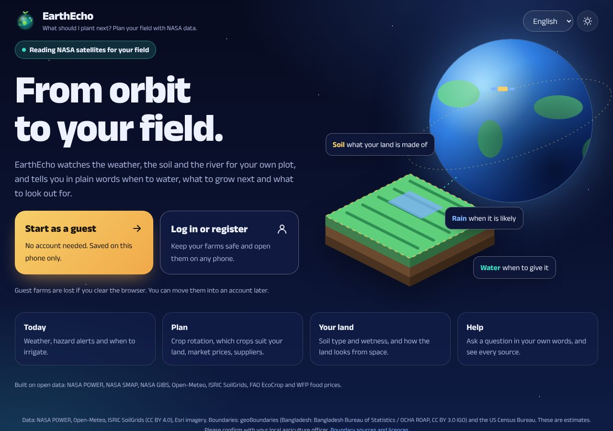

# EarthEcho

### From orbit to your field.

**A free English and Bengali farm planner that reads NASA data for a farmer's own land and compares crop-rotation strategies in plain words.**

     

NASA Space Apps Challenge 2026 · Team **Frontier Zero** · Challenge **Field Shift: Adapting Farms with NASA Data**

**[Open the live app](https://earth-echo-nine.vercel.app/)** · [Demo script](docs/DEMO.md) · [Submission answers](docs/SUBMISSION.md) · [Licence](LICENSE)

</div>

---

## Try it in one minute

| | |
|---|---|
| **Live app** | https://earth-echo-nine.vercel.app/ |
| **Demo account (phone)** | `018564344011` |
| **Demo account (password)** | `1234567890` |
| **No account?** | Tap **Start as a guest** on the first screen. Everything works the same; it is saved on that phone only. |
| **Demo place** | Mokamtala, Shibganj, Bogura, Bangladesh |
| **Language** | Use the language button at the top. English and Bengali cover every screen. |

The demo account is shared and public so judges can look around. Please do not change its password. If you want a clean start, use guest mode.

**A five-step path through the app**

1. Log in with the demo account (or start as a guest).
2. **My Farm**: see the two plots, *Dhan jomi* and *Alu jomi*. Switch plots at the top; every tab changes with them.
3. **Rotation planner**: pick a goal, open a strategy, read the *How sure are we?* box, then move the weather sliders.
4. **Weather** and **Irrigation**: see whether to water today, and why.
5. Switch to **বাংলা** and open **Ask EarthEcho**.

> **About the pictures.** They were taken from the real app using sample values for the Mokamtala demo place, because the screenshot environment cannot reach NASA. On the live site the same screens show real readings and real satellite imagery. English is shown first and Bengali second.

## Contents

1. [The idea](#the-idea)
2. [How a farmer uses it](#how-a-farmer-uses-it) (landing, sign-in, land picker, loading)
3. [Every screen, in detail](#every-screen-in-detail) (12 tabs)
4. [Works on phones, in Bengali, in light mode](#works-on-phones-in-bengali-in-light-mode)
5. [What it does for the Field Shift challenge](#what-it-does-for-the-field-shift-challenge)
6. [How the strategies are worked out](#how-the-strategies-are-worked-out)
7. [How it is built](#how-it-is-built)
8. [Honest limits](#honest-limits)
9. [Run it on your computer](#run-it-on-your-computer)
10. [Privacy and accounts](#privacy)
11. [Team, licence, credits, terms](#team)

## The idea

A farmer choosing the next crop has little local evidence in a language and format they can use. EarthEcho lets the farmer **drop a pin on their own land**, then reads NASA climate and satellite data for that exact place and answers in plain words: what suits the land, when to water, what danger is coming, what crops sell for, and which rotation to consider. It **supports the farmer's judgment and never replaces it**. It gives no yield or income forecast, marks every number as *entered*, *assumed* or *estimated*, and points to the local agriculture officer.

## How a farmer uses it

### Step 1. Landing: guest or account

<table><tr><td width="50%"></td><td width="50%">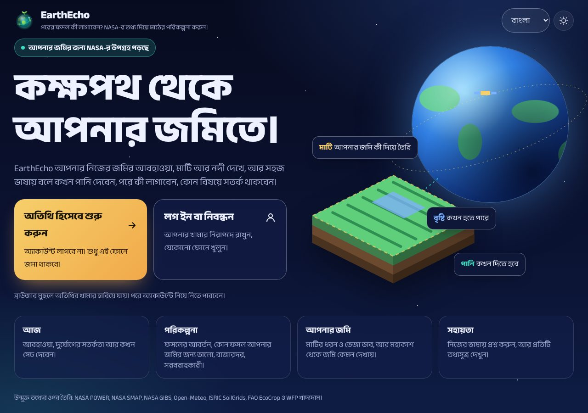</td></tr></table>

The first screen explains the app in one sentence and offers two doors: **Start as a guest** (no account, saved on the phone) or **Log in or register**. The four cards preview the menu: Today, Plan, Your land, Help.

### Step 2. Sign up or log in

<p align="center">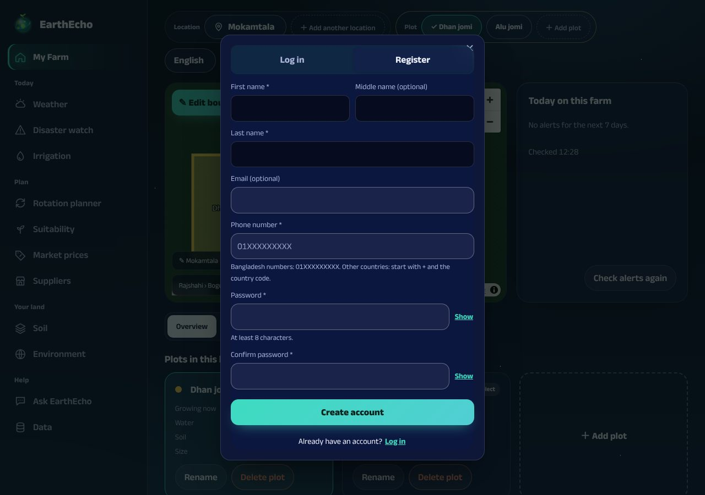</p>

Register with a first name, last name (middle name and email are optional), phone number and password (at least 8 characters). There is **no text-message code**: the phone number is not verified, and the password is stored as a scrypt hash. An account keeps locations and plots in a database so they open on any phone. Guests can move their farms into an account later.

### Step 3. Place your land

<table><tr><td width="50%">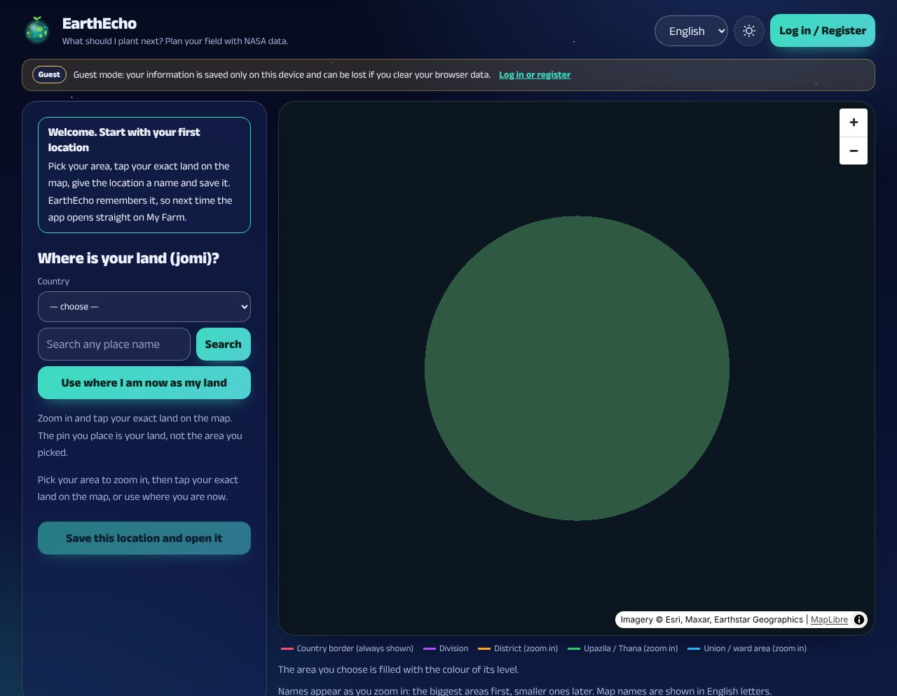</td><td width="50%">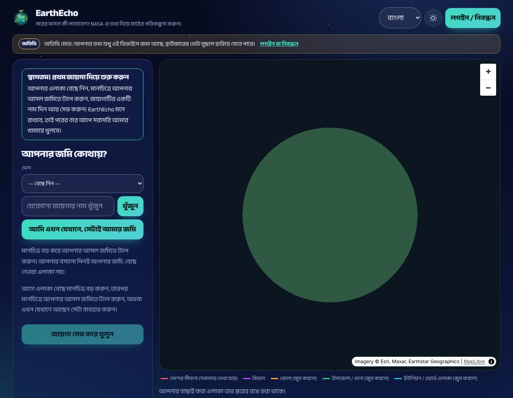</td></tr></table>

Pick the **area** (country, division, district, upazila, union, or search any place name, or use *where I am now*). Choosing an area only **zooms the map**. Then tap the map to drop a pin on the **exact land (jomi)**. **Save this location and open it** stays off until the pin is placed, so the saved place is the land, not the area. On the live site the map shows satellite imagery with colour-coded boundaries (country, division, district, upazila, union). Bangladesh is supported down to union level, plus India, Nepal, Myanmar, Pakistan, Bhutan and the USA.

### Step 4. EarthEcho prepares your land

<table><tr><td width="50%">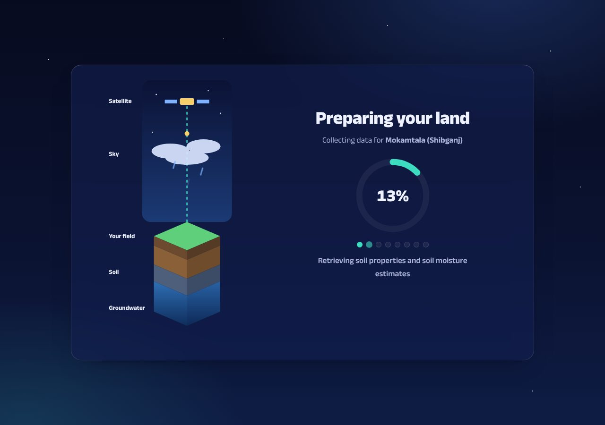</td><td width="50%">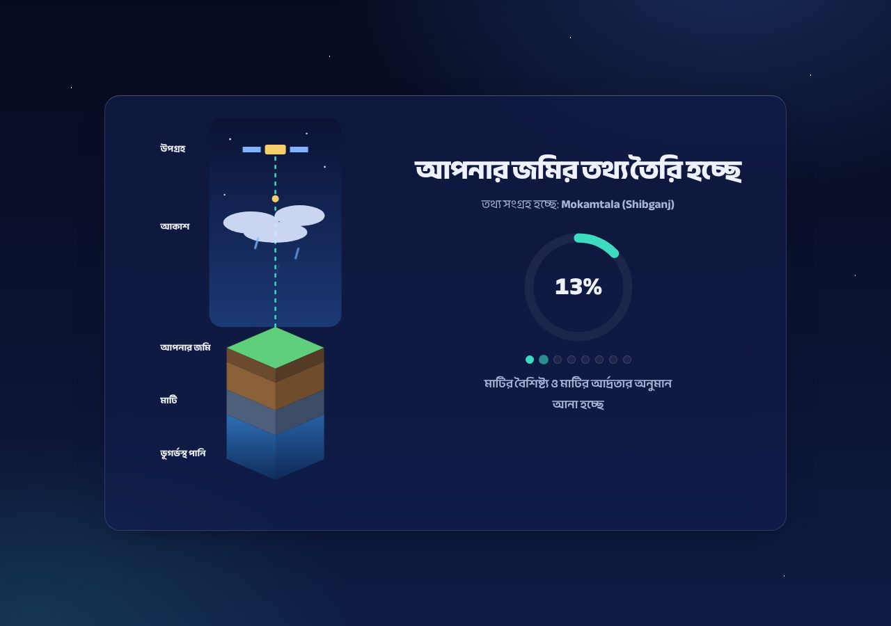</td></tr></table>

A fixed-height loading screen with a percentage and eight steps. Its eight steps are: the area, soil, weather, 25 years of climate, height and slope, vegetation greenness, water and the crop-suitability scores. A step is ticked only when its data really arrived, and says plainly when it did not. A farmer can **Skip** to open the app early; pieces that are not ready load in the background.

## Every screen, in detail

The left menu groups the 12 tabs as **Today** (Weather, Disaster watch, Irrigation), **Plan** (Rotation planner, Suitability, Market prices, Suppliers), **Your land** (Soil, Environment) and **Help** (Ask EarthEcho, Data), with **My Farm** on top. The header has a **Location** switcher (with *+ Add another location*) and a **Plot** switcher (with *+ Add plot*), then the language, light or dark mode and the account.

### 1. My Farm

**Save your land once. Everything else follows it.**

The hub. A farmer keeps **locations** (a village or area) and, inside each, up to 12 **plots** (single parcels of land). Every other tab reads the plot that is open in the header.

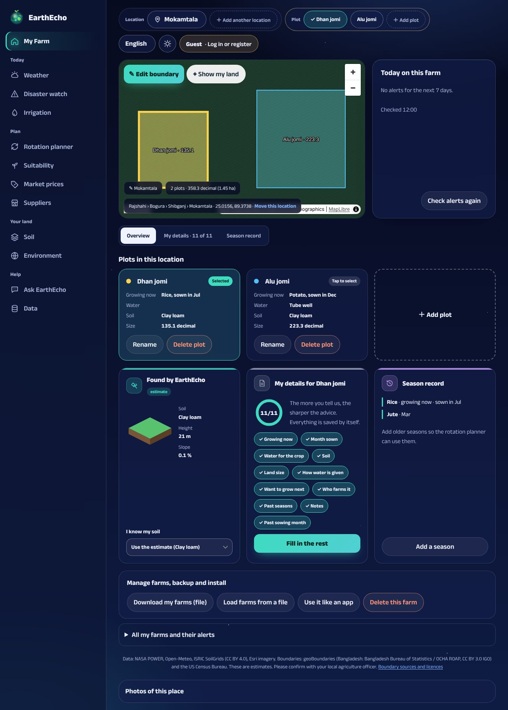

<details><summary><b>বাংলা</b> and <b>phone</b> versions of this screen</summary>

<table><tr><td width="62%">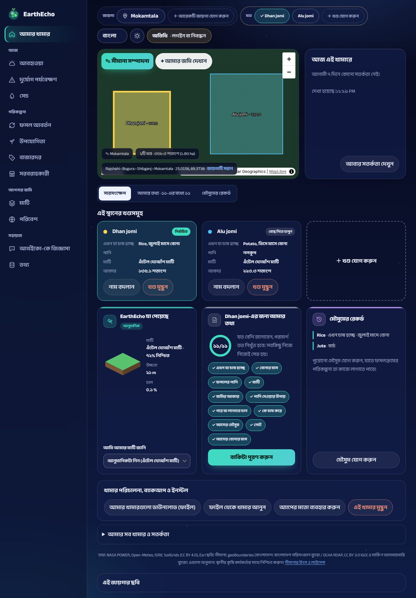</td><td width="38%">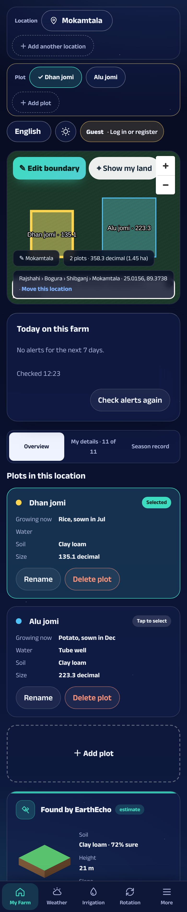</td></tr></table>

</details>

**How it works**

- The farmer taps the map to place a pin on their own land, then draws the plot boundary (**Edit boundary**). **Land size fills in from the boundary** in decimal, and the farmer can overwrite it in bigha, acre, katha, hectare or square metre.
- **Found by EarthEcho** shows soil, height above sea level and slope. They are always marked *estimate*. If the farmer knows better, **I know my soil** replaces the estimate everywhere and keeps the original.
- **My details** (11 optional items: crop now, month sown, water for the crop, how water is given, soil, land size, crop to grow next, who farms it, past seasons, notes) fill a progress ring. Whatever the farmer types is marked *You entered* and is used instead of an estimate.
- **Season record** keeps past crops and sowing months so the rotation planner can use them.
- **Today on this farm** lists alerts for the next 7 days. **Download my fields** makes a backup file that moves everything to another phone.

**Data:** NASA POWER and ISRIC SoilGrids (estimates), Open-Meteo elevation (height and slope), the farmer's own entries.


### 2. Weather

**Is today good for field work, and is this season normal?**

Plain words first ("A good day for field work. No rain."), numbers second.

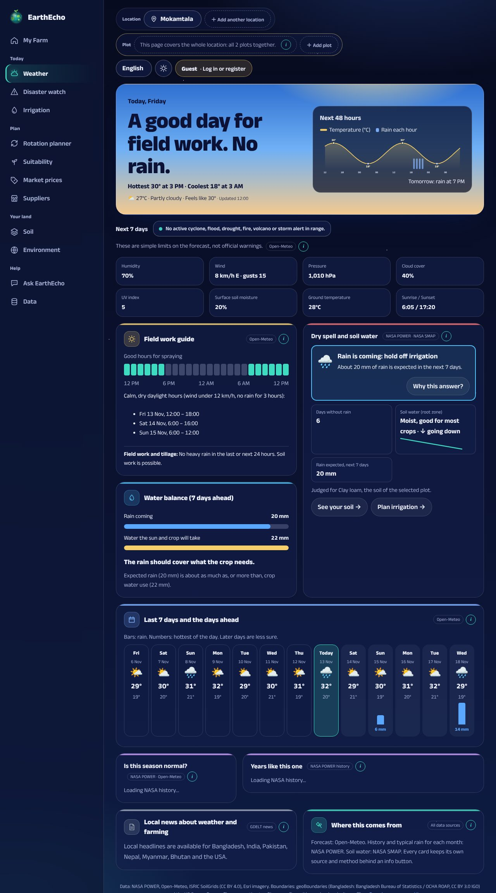

<details><summary><b>বাংলা</b> and <b>phone</b> versions of this screen</summary>

<table><tr><td width="62%">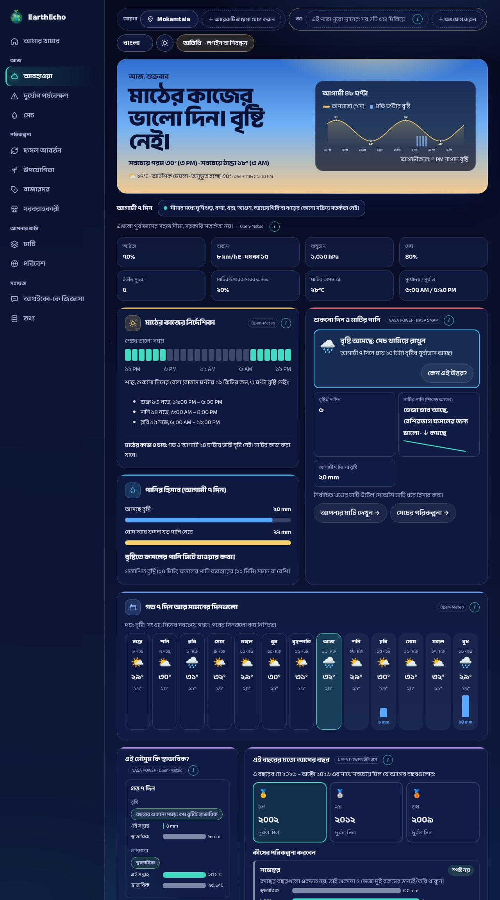</td><td width="38%">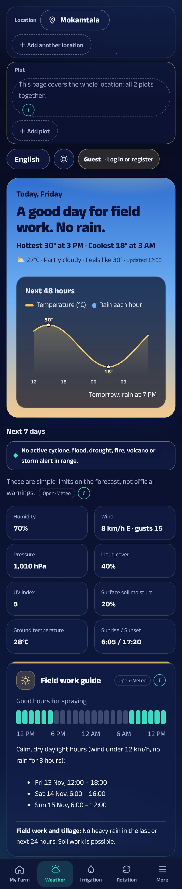</td></tr></table>

</details>

**How it works**

- A 48-hour temperature and rain chart, then a 7-day strip with the high, low and rain for each day, and a row of facts (humidity, wind, pressure, cloud, UV, soil wetness, sunrise and sunset).
- **Field work guide** marks the calm, dry daylight hours that are good for spraying and says whether soil is workable.
- **Dry spell and soil water** counts days without rain (NASA POWER) next to how wet the soil is (NASA SMAP) and says whether to hold off irrigation. **Water balance** compares the rain coming with the water the sun and crop will take.
- **Is this season normal?** compares the past and coming week with NASA's 25-year record for the same time of year at this place.

**Data:** Open-Meteo forecast, NASA POWER, NASA SMAP through NASA GIBS.


### 3. Disaster watch

**Is anything dangerous near the farm?**

A radar picture of the 500 km around the farm and one word for the overall state (here: *Calm*).

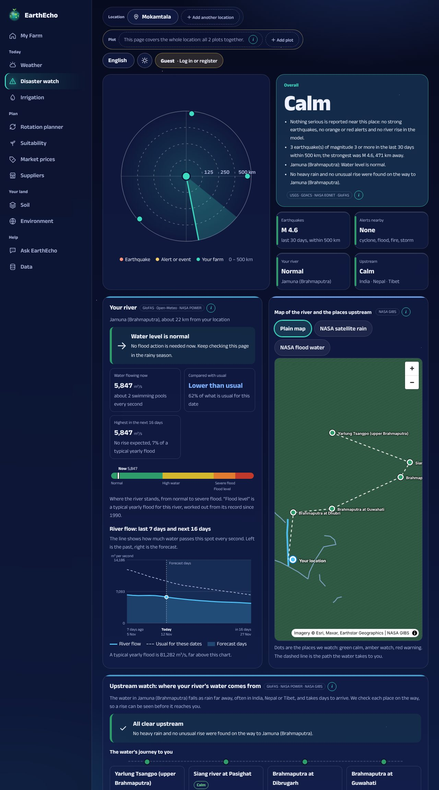

<details><summary><b>বাংলা</b> and <b>phone</b> versions of this screen</summary>

<table><tr><td width="62%">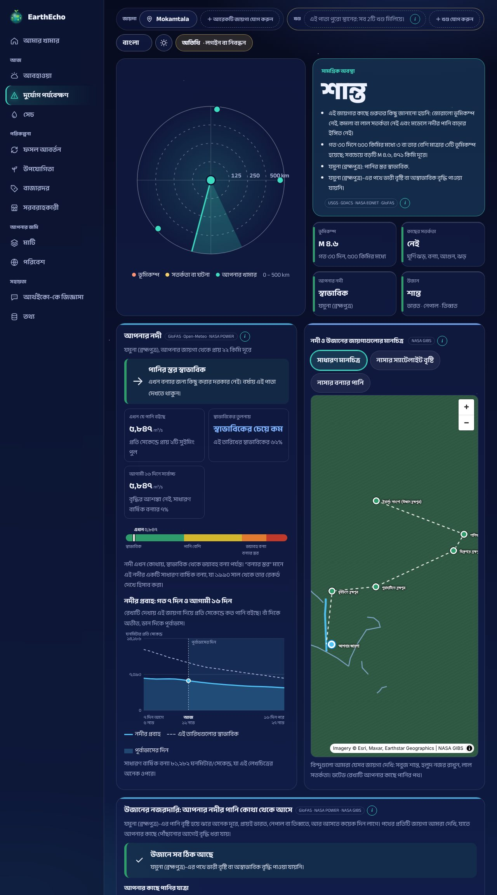</td><td width="38%">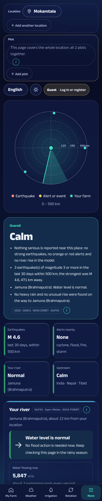</td></tr></table>

</details>

**How it works**

- Four independent sources are read separately, so one failing never hides the others: USGS earthquakes (30 days), GDACS cyclone, flood, drought and fire alerts, NASA EONET natural events, and a river-flow model for floods.
- **Your river** shows the nearest river, the flow now compared with usual for the date, and the highest flow expected in the next 16 days.
- **Upstream** follows the river back to where its water comes from and shows NASA satellite rain and flood-water layers on the map, because a flood in Bogura often starts in Nepal, India or Tibet days earlier.

**Data:** USGS, GDACS, NASA EONET, GloFAS river model through Open-Meteo, NASA GIBS.


### 4. Irrigation

**Water today, or wait?**

One headline (*Irrigate today*, *Wait*), the water in millimetres and litres, and how sure the app is.

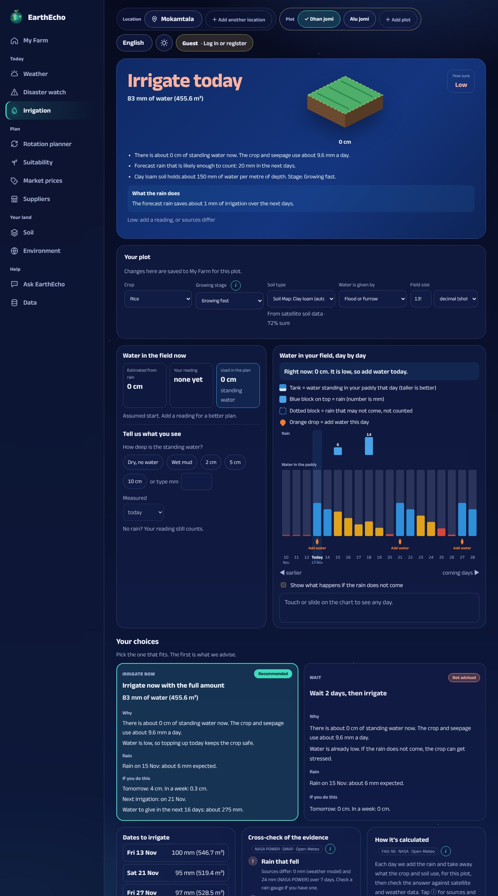

<details><summary><b>বাংলা</b> and <b>phone</b> versions of this screen</summary>

<table><tr><td width="62%">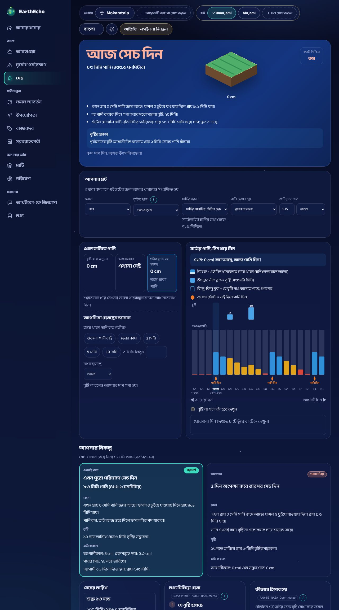</td><td width="38%">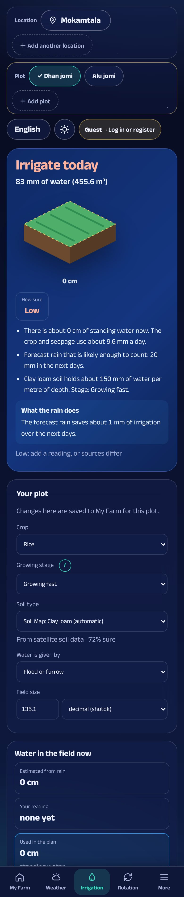</td></tr></table>

</details>

**How it works**

- Uses the **crop and land size from My Farm**, so nothing is typed twice. The farmer sets only the growth stage, how water is given (flood or furrow, sprinkler, drip) and soil type.
- For **rice** it keeps a paddy water account: standing water in cm, seepage and use per day, and the rain that is forecast. For **upland crops** it keeps a root-zone water account based on the soil's holding capacity (for example clay loam holds about 150 mm per metre of depth).
- **Tell us what you see** lets the farmer enter the real standing-water depth. A reading replaces the assumed start and raises the confidence.
- The day-by-day chart shows rain that is counted and rain that may not come, so the farmer sees why the advice is what it is.

**Data:** Open-Meteo forecast and evapotranspiration, NASA POWER, the farmer's crop, land size and soil.


### 5. Rotation planner

**Compare what to plant next. The challenge's core tab.**

Four goals (**Save water, Earn more, Improve soil, Lower risk**) re-rank the strategies. A 12-month wheel shows the best one.

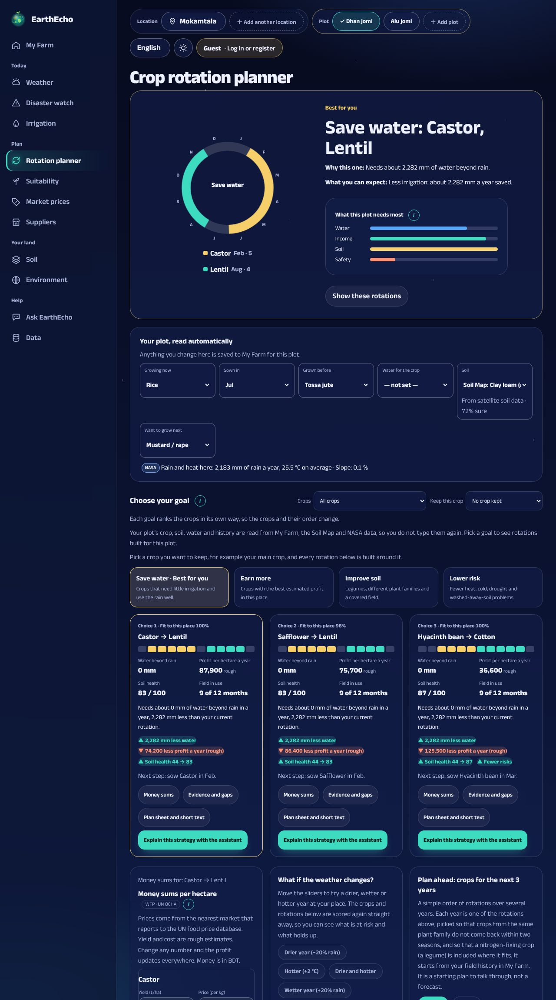

<details><summary><b>বাংলা</b> and <b>phone</b> versions of this screen</summary>

<table><tr><td width="62%">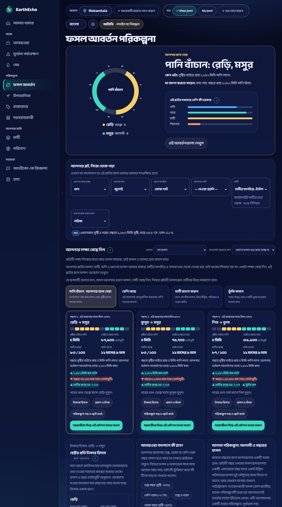</td><td width="38%">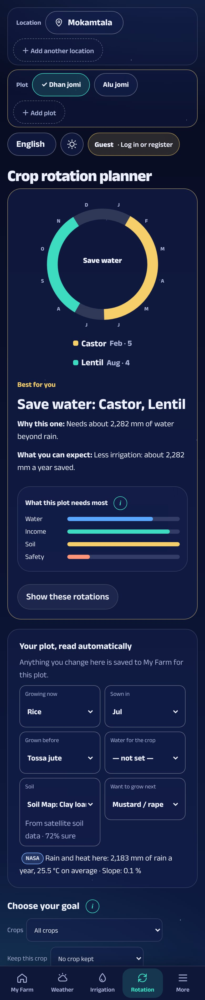</td></tr></table>

</details>

**How it works**

- The farmer's current rotation sits next to the best alternatives in a side-by-side table and three detailed choice cards with a month-by-month strip.
- Each strategy is explained in five parts (why suggested, evidence, benefits, information gaps, risks) with a **How sure are we?** box listing what was entered, assumed or missing.
- **What if the weather changes?** sliders show how crops and the top strategy change in a drier, wetter, hotter or cooler season. **NASA evidence** shows 25 years of temperature and rain and a 12-month field calendar.
- **Keep this crop** builds every rotation around the farmer's main crop. **Explain this strategy** sends it to the assistant, which answers in the app's language.
- It never says *switch crops* and gives no yield or income forecast. How the scores work is in [How the strategies are worked out](#how-the-strategies-are-worked-out).

**Data:** FAO EcoCrop limits, NASA POWER monthly climate, ISRIC SoilGrids, WFP prices, the farmer's entries.


### 6. Market prices

**What are crops selling for near me?**

Latest food prices from the nearest markets, with the farmer's likely share.

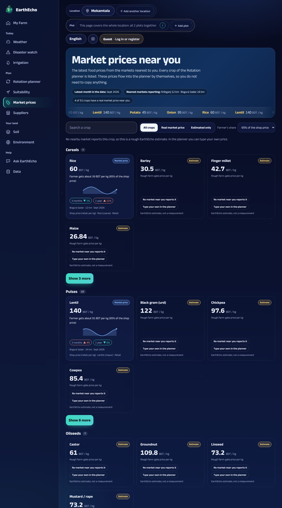

<details><summary><b>বাংলা</b> and <b>phone</b> versions of this screen</summary>

<table><tr><td width="62%">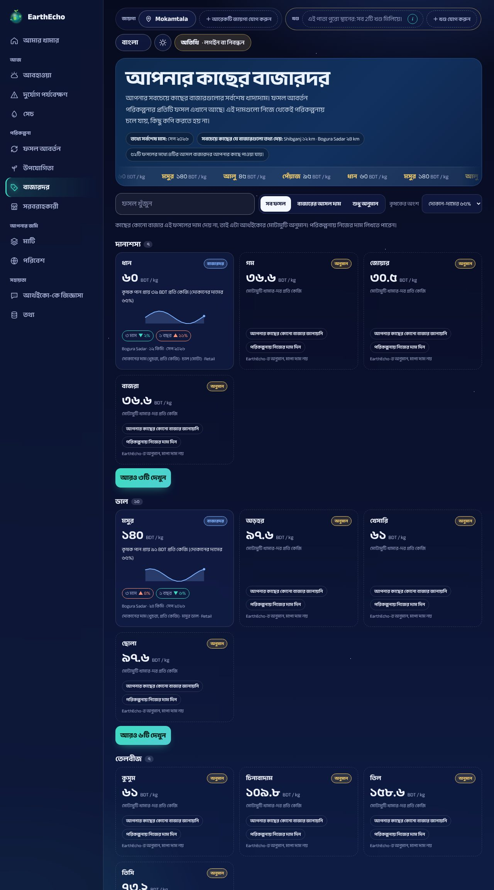</td><td width="38%">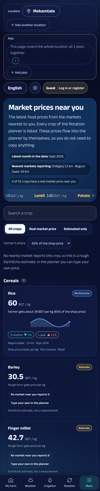</td></tr></table>

</details>

**How it works**

- Each crop card shows the price per kg, the change over 3 months and 12 months, which market reported it and how far away it is.
- Prices WFP reports are **shop prices**, so the app also shows what the farmer is likely paid at the farm gate (default 65%, adjustable). Crops with no market report are marked *Estimate*, never passed off as measured.
- These prices flow into the rotation planner's profit workings by themselves.

**Data:** WFP food prices through the Humanitarian Data Exchange (CC BY-IGO).


### 7. Suppliers

**Where can I buy seed, fertiliser or get advice?**

A map and a nearest-first list inside a 10, 25 or 50 km radius.

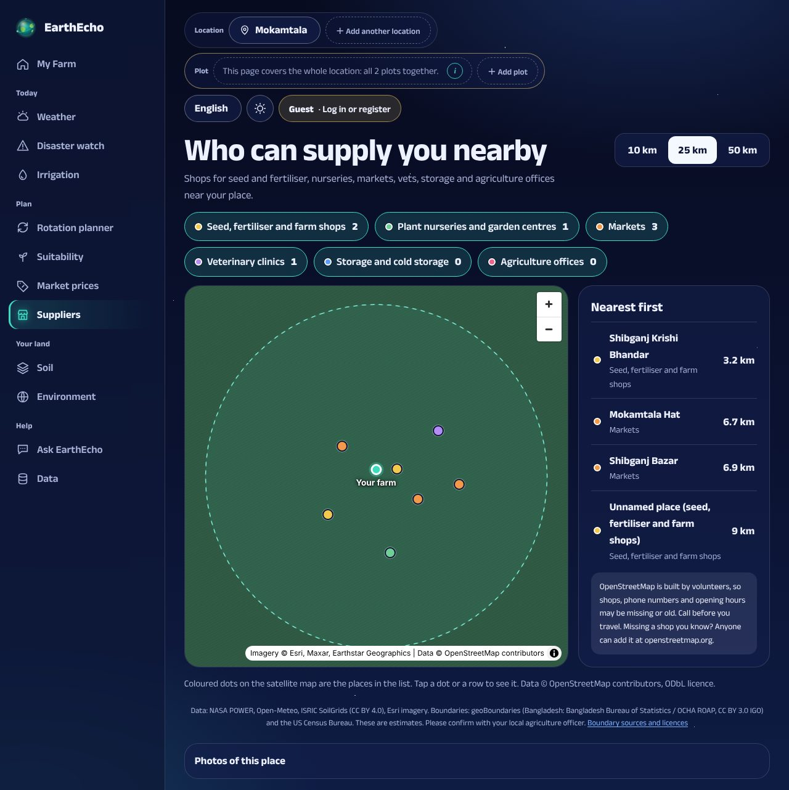

<details><summary><b>বাংলা</b> and <b>phone</b> versions of this screen</summary>

<table><tr><td width="62%">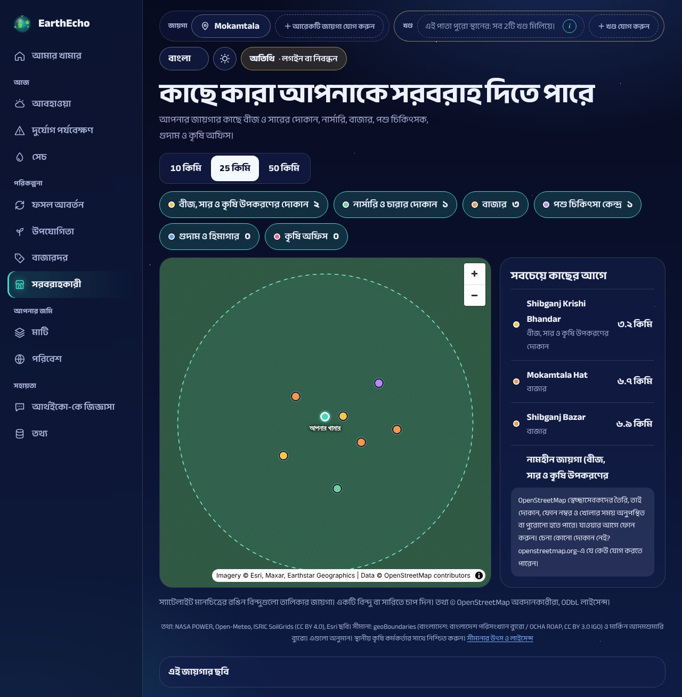</td><td width="38%">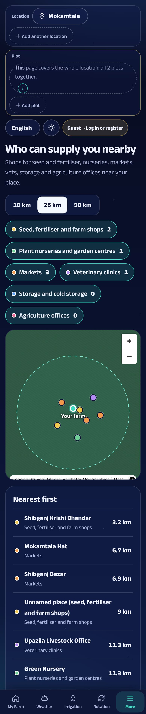</td></tr></table>

</details>

**How it works**

- Groups: seed, fertiliser and farm shops, plant nurseries, markets, veterinary clinics, storage and cold storage, agriculture offices.
- Each place shows its distance and, where volunteers have added them, opening hours and phone. The page reminds farmers to call before travelling and that anyone can add a missing shop on OpenStreetMap.

**Data:** OpenStreetMap contributors (ODbL).


### 8. Ask EarthEcho

**Ask in your own words, in Bengali or English.**

An assistant that knows this plot.

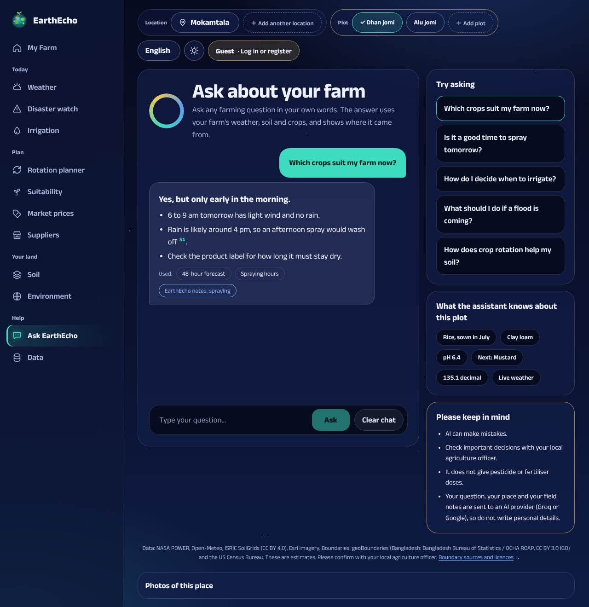

<details><summary><b>বাংলা</b> and <b>phone</b> versions of this screen</summary>

<table><tr><td width="62%">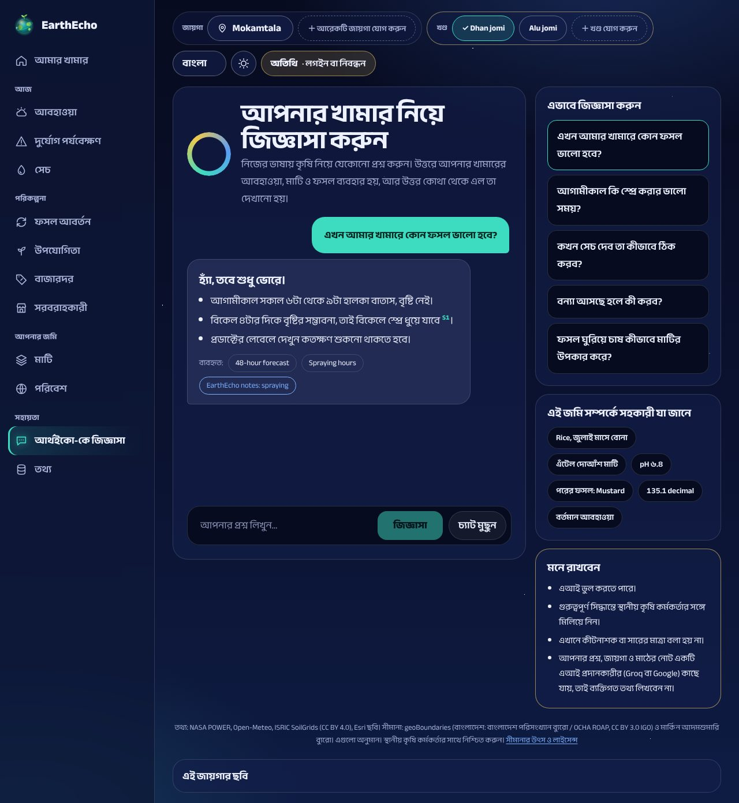</td><td width="38%">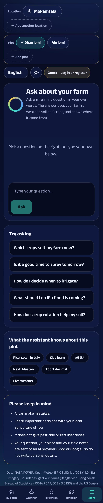</td></tr></table>

</details>

**How it works**

- Suggested questions (*Which crops suit my farm now?*, *Is it a good time to spray tomorrow?*) or free typing.
- It answers **only** from this plot's live data and a sourced knowledge base, shows numbered source badges on each answer, and says when it does not know.
- The box *What the assistant knows about this plot* lists the crop, soil, pH, next crop, land size and weather it was given.
- It never gives pesticide or fertiliser doses and always points to the local agriculture officer.

**Data:** Groq (primary) and Google Gemini (backup) language models over EarthEcho's own knowledge base.


### 9. Suitability

**Which crops suit this place?**

Every crop gets a score from 0 to 100 for this place, from its weather and soil.

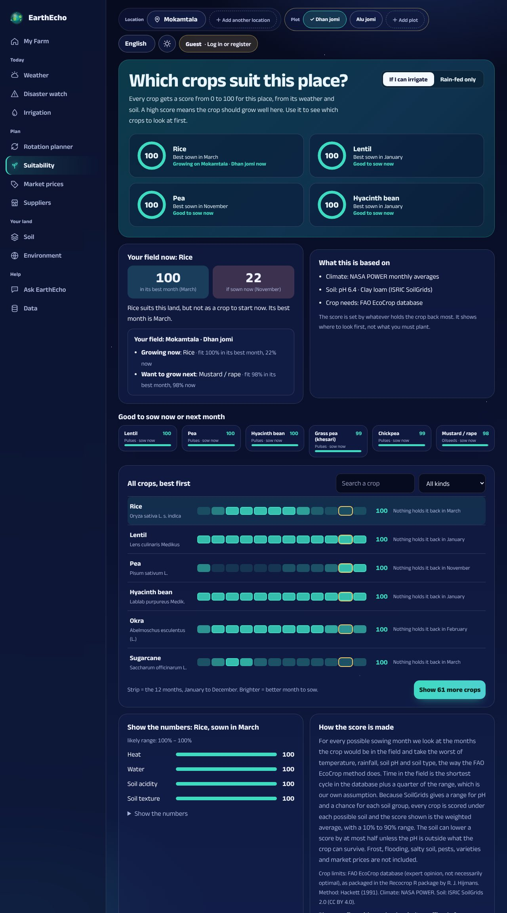

<details><summary><b>বাংলা</b> and <b>phone</b> versions of this screen</summary>

<table><tr><td width="62%">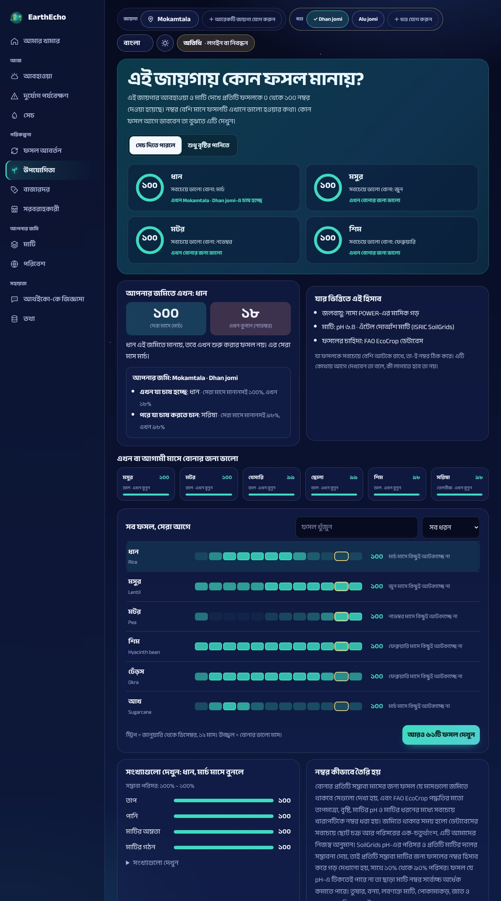</td><td width="38%">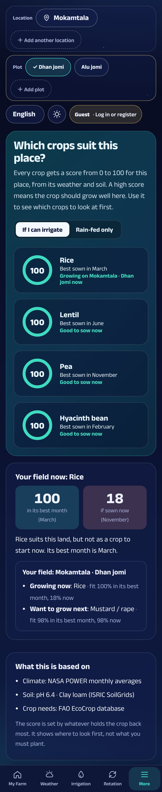</td></tr></table>

</details>

**How it works**

- Switch between **If I can irrigate** and **Rain-fed only**. The score is set by whatever holds the crop back most (the FAO EcoCrop method), so it shows where to look first, not what you must plant.
- **Your field now** rates the farmer's own crop in its best month and if sown now. **Good to sow now or next month** lists what fits the coming weeks. **All crops, best first** has search and a filter by kind.

**Data:** FAO EcoCrop, NASA POWER monthly climate, ISRIC SoilGrids.


### 10. Soil

**What is my soil, and how sure are we?**

A 3D block of the topsoil, subsoil and deep soil, with the most likely soil type (here *Clay loam*) and its local Bengali name.

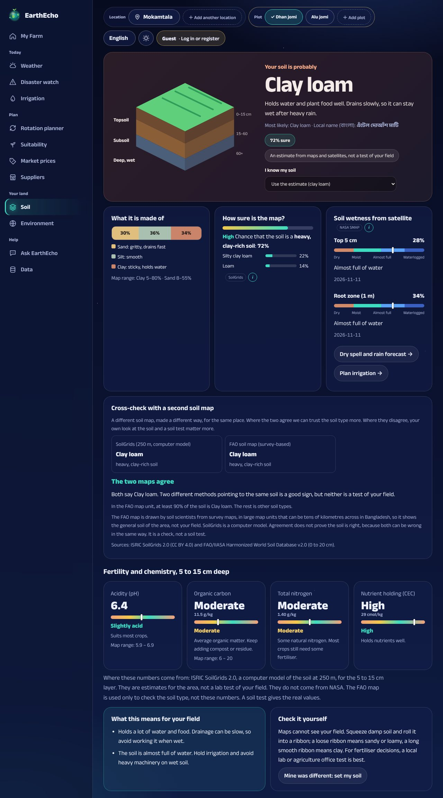

<details><summary><b>বাংলা</b> and <b>phone</b> versions of this screen</summary>

<table><tr><td width="62%">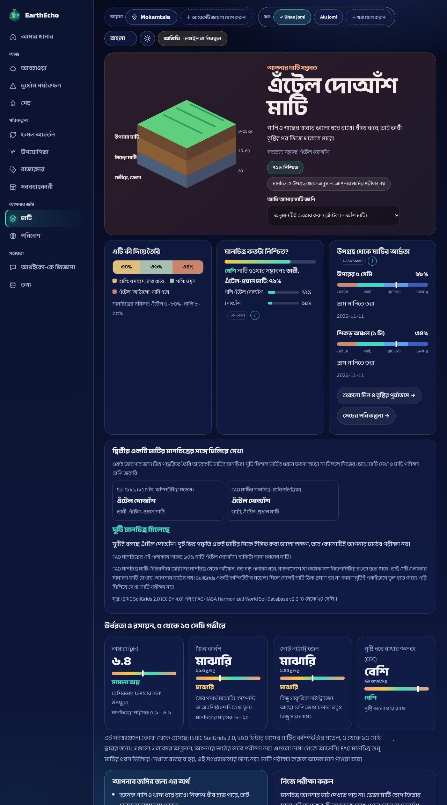</td><td width="38%">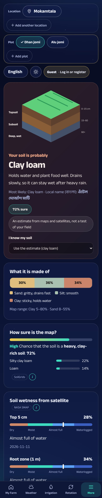</td></tr></table>

</details>

**How it works**

- Sand, silt and clay shares, pH, organic carbon, nitrogen and cation exchange, with a plain-words meaning for each.
- **How sure is the map?** gives a percentage and the second-best guesses, so the farmer sees the uncertainty.
- **Soil wetness from satellite** shows top 5 cm and root-zone (1 m) wetness from NASA SMAP. A **cross-check** compares a second soil map and says where the two agree.
- **I know my soil** lets the farmer override the estimate.

**Data:** ISRIC SoilGrids 2.0 (CC BY 4.0), NASA SMAP, FAO and IIASA HWSD.


### 11. Environment

**Your land, seen from space.**

NASA map layers with a time slider, then the same data as plain cards.

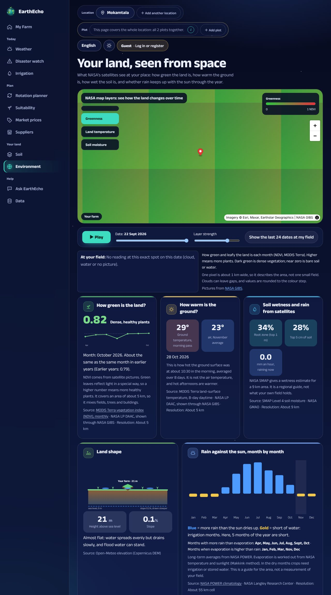

<details><summary><b>বাংলা</b> and <b>phone</b> versions of this screen</summary>

<table><tr><td width="62%">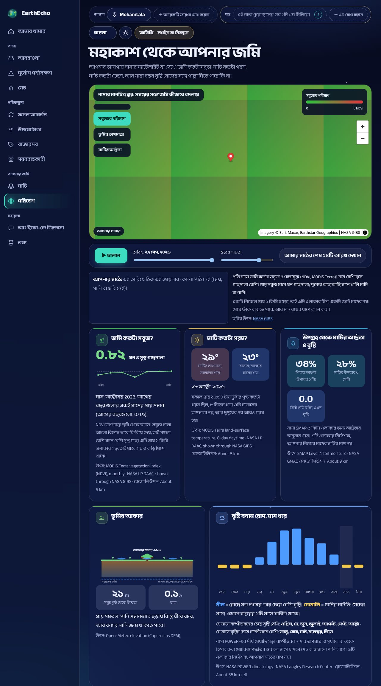</td><td width="38%">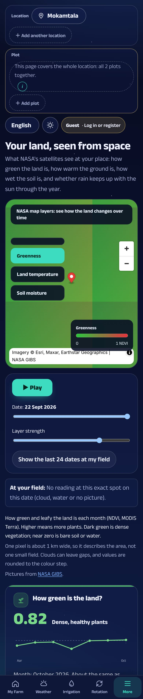</td></tr></table>

</details>

**How it works**

- **Greenness** (MODIS NDVI), **Land temperature** (MODIS) and **Soil moisture** (SMAP) on a map. Drag the slider or press **Play**, and read the value at the farm. *Show the last 24 dates at my field* draws a small history chart.
- Cards explain what each reading means and its resolution (for example, one pixel is about 1 km, so it describes an area, not one small field).
- **Land shape** shows height above sea level and slope, with a profile picture of how water will move. **Rain against the sun** shows, month by month, where rain beats evaporation and which months are short of water.

**Data:** NASA GIBS (MODIS, SMAP), NASA POWER climatology, Open-Meteo elevation (Copernicus DEM).


### 12. Data and sources

**Every number has a source you can check.**

Live NASA values for the farm, the satellites explained, and a table of every source.

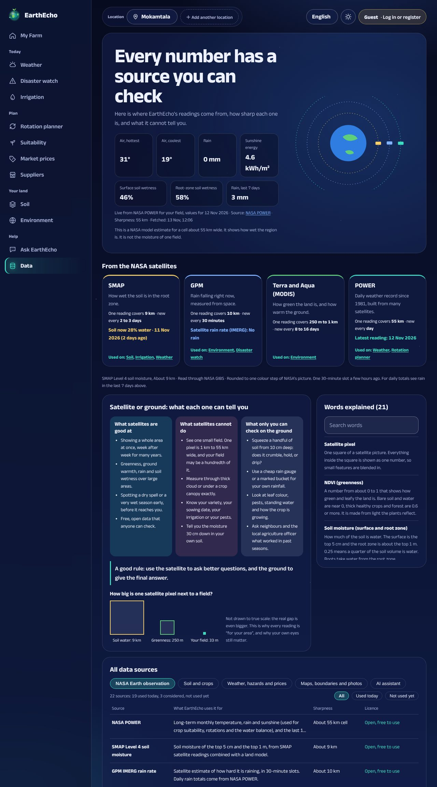

<details><summary><b>বাংলা</b> and <b>phone</b> versions of this screen</summary>

<table><tr><td width="62%">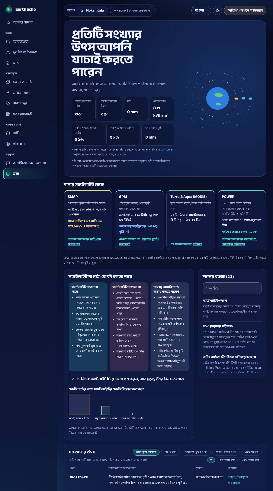</td><td width="38%">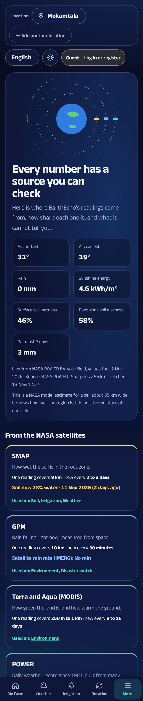</td></tr></table>

</details>

**How it works**

- **Live from NASA POWER:** today's hottest and coolest air, rain, sunshine energy and soil wetness for the farm.
- Four satellite cards (**SMAP, GPM, MODIS, POWER**) say what each measures, its resolution, how often it updates and which tabs use it.
- **Satellite or ground** explains what a satellite can and cannot tell you, with a one-pixel against one-hectare picture. A glossary explains 21 terms in both languages.
- The source table lists publisher, resolution, update rate, licence and status (live or planned) for every source, with a flag where a licence has not been fully read.

**Data:** All sources listed in [Credits and citations](#credits-and-citations).


## Works on phones, in Bengali, in light mode

The app is built phone first, installs like an app from the browser and opens offline with the last data it saw. Every screen above exists in Bengali. Dark mode is the default and light mode is one tap.

<table><tr>
<td>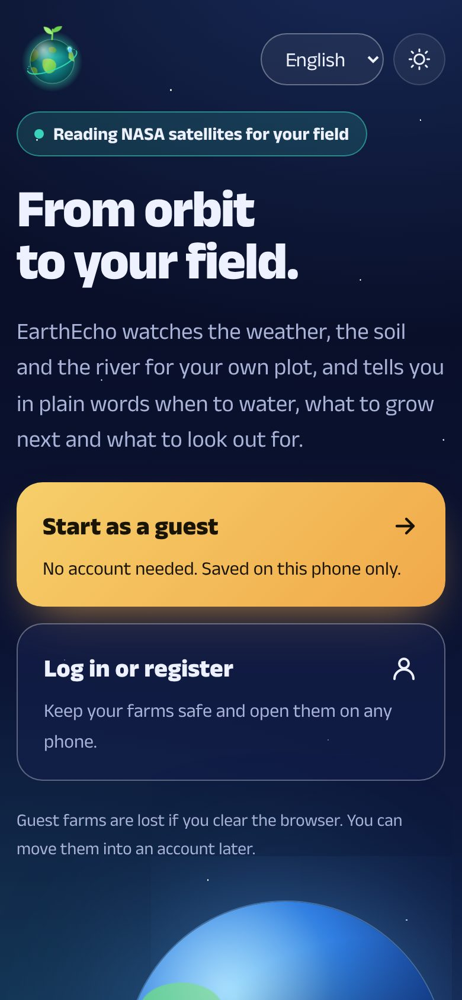</td>
<td></td>
<td></td>
</tr><tr>
<td></td>
<td></td>
<td></td>
</tr></table>

**Light mode**

<table><tr><td width="50%">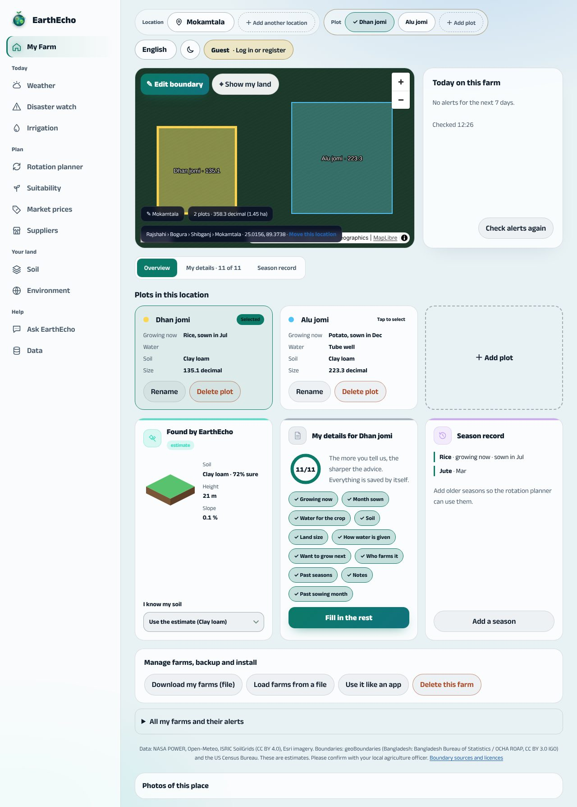</td><td width="50%">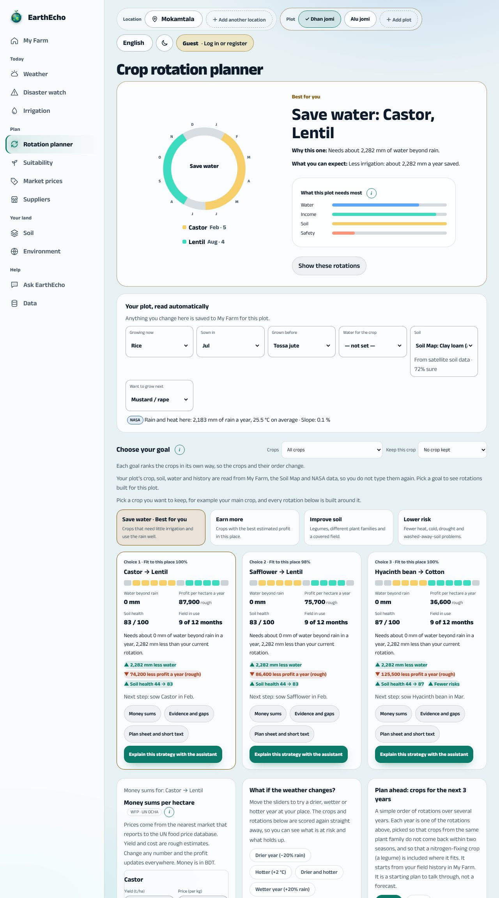</td></tr></table>

## What it does for the Field Shift challenge

The challenge asks for a supportive tool that compares crop-rotation strategies, explains them, and does not replace the farmer's judgment.

| Challenge need | What EarthEcho does | Where |
|---|---|---|
| Compare several strategies | The farmer's current rotation plus the best alternatives, side by side in one table and in detail cards | Rotation planner |
| Explain each strategy | Five parts each: why suggested, evidence, benefits, information gaps, risks | Open any strategy card |
| Use NASA data | NASA POWER (25 years of temperature and rain, daily weather), NASA GIBS layers (MODIS greenness and land temperature, SMAP soil moisture, GPM rain) with a time slider, NASA EONET events | Rotation planner, Weather, Environment, Disaster watch, Data |
| Let the farmer say what matters | Save water, earn more, improve the soil, lower risk; strategies re-rank. Fit to the place still counts for 40% of each score | Rotation planner, goal cards |
| Show how conditions may change | What-if sliders for rain and temperature | Rotation planner |
| Be honest about uncertainty | A *How sure are we?* box on every strategy: what was entered, assumed or missing | Inside each strategy |
| Support, not replace, the farmer | The farmer's own values are used and labelled *You entered*. Every answer points to the local agriculture officer. No yield or income forecast | My Farm, all tabs |
| Be understandable | Plain words, visuals before text, a glossary of 21 terms, English and Bengali | Everywhere, Data |
| Explain in the farmer's language | The assistant answers in the app's language | Ask EarthEcho |

## How the strategies are worked out

- **Candidate rotations** of two or three crops are built from the FAO EcoCrop climate and soil scores for the place, using NASA POWER monthly averages for temperature and rain.
- **Each rotation is measured**: average fit, months the field is in use, bare months and which of them are very wet, nitrogen-fixing crops, plant families, and the water needed beyond rain.
- **The farmer's own rotation** uses the sowing months they entered. If they did not enter any, the app assumes each crop's best month and says so.
- **Priorities** (save water, earn more, improve the soil, lower risk) change the ranking, but fit to the place always counts for 40%, so a rotation that does not suit the climate cannot win on priorities alone.
- **"How sure"** counts inputs that are known, assumed or missing, and adds flags for weak points (a crop that only moderately fits, a large water gap, a field bare in very wet months). It is a guide, not a statistical confidence interval.
- **Nothing is forecast.** There is no yield or income model.

## How it is built

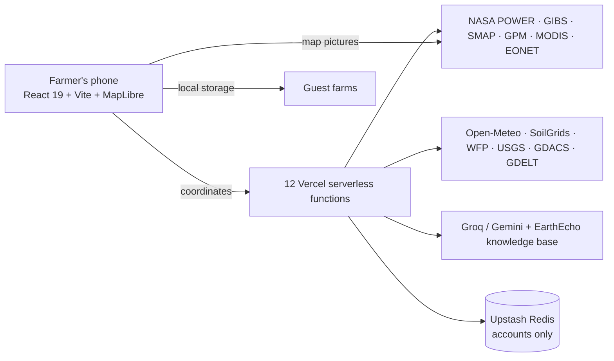

| Layer | What | Notes |
|---|---|---|
| App | React 19, Vite 8, MapLibre GL, hash routes | One file per tab. Text in `src/i18n*.js` (English and Bengali). Themes in `src/orbit.css` |
| Saved land | `src/fields.js`: locations with plots | Guests use localStorage; accounts sync to the database |
| Strategy engine | `src/strategy.js`, `src/trust.js`, `src/crops.js` | Rule-based; the *How sure* rating counts known, assumed and missing inputs |
| Server | `api/*.js`, shared code in `api/_lib/` | Kept to 12 functions to stay on the free Vercel plan |
| Offline | `public/sw.js`, web app manifest | Installs like an app; opens with the last data |

**The 12 server functions**

| Function | What it does |
|---|---|
| `account` | Register, log in, log out, load and save My Farm (one function for all actions) |
| `assistant` | Finds matching knowledge pieces plus the farm's live data, asks the language model, returns a cited answer |
| `disasters` | USGS earthquakes, GDACS alerts, NASA EONET events, river flow and upstream |
| `dryspell` | Days in a row without rain (NASA POWER) next to SMAP soil moisture |
| `environment` | MODIS greenness and land temperature, NASA POWER climate normals and monthly water balance |
| `layers` | Which dates really exist for each NASA map layer, and their colour tables |
| `markets` | WFP food prices near the point |
| `news` | Local weather and farming headlines (titles and links only) |
| `power-daily` | NASA POWER daily weather, rain, solar energy and soil wetness |
| `satellite` | Latest SMAP soil moisture and GPM rain rate |
| `soil` | SoilGrids 2.0 soil properties with uncertainty |
| `trend` | 25-year temperature and rain trend, with detection of data jumps |

## Honest limits

- Everything is an **estimate**. Soil comes from a 250 m satellite model, climate from monthly averages. The app says so and asks farmers to confirm with their local agriculture officer.
- NASA data describes an area (about 1 to 55 km wide), not one field.
- Crop suitability tells where to look first, not what to plant.
- The strategy comparison is rule-based (fit, bare months, legumes, crop families, water gap, heat and cold months). It is **not a yield model** and does not forecast income.
- In irrigated mode the fit ignores rain, so many alternatives show 100%. A second row shows the fit on rain alone.
- NASA POWER's yearly rainfall for some places (for example Bangladesh) jumps around 2016, which looks like a change in NASA's inputs. The app detects such jumps, claims no trend there and says so.
- The "how sure" rating counts what is measured, assumed or missing. It is a guide, not a statistical confidence interval.
- Data licences are on the Data tab. Still flagged: the FAO EcoCrop page's own user agreement was not read in full, and the Esri satellite basemap's current free-use terms could not be confirmed (fine for a non-commercial demo; check before commercial use).
- The AI assistant answers only from the farm data and its knowledge base, cites its sources, and says when it does not know. It can make mistakes, and it runs on free tiers with a rate limit.
- Saved fields live in the browser of one phone. Clearing browser data removes them. The **Download my fields** file is the backup.

## Run it on your computer

```
npm install
npm run dev
```

Open http://localhost:5173. The `/api` folder runs locally the same way it runs on Vercel.

For the AI assistant, create a file `.env.local` in the project folder (it is never committed):

```
GROQ_API_KEY=your-key
```

`GEMINI_API_KEY` can be added as a backup. On Vercel, add the same names under Project Settings, Environment Variables.

Accounts are optional. To turn them on, add a free Upstash Redis database (`KV_REST_API_URL` and `KV_REST_API_TOKEN`). Without it the app runs in guest mode and the sign-in button says accounts are not available. Details: [docs/ACCOUNTS.md](docs/ACCOUNTS.md).

## Build and deploy

```
npm run build
```

Vercel builds and publishes on every push to `main`. `vercel.json` sets the time limits of the slower API functions.

## Privacy

Guests: no account, no tracking and no advertising. Locations and details stay on the device. With an account: the phone number, name, a scrypt password hash and the saved locations are stored in an Upstash Redis database, and the login cookie is HttpOnly. Phone numbers are not verified by text message. The place's coordinates are sent to the data services (NASA, Open-Meteo, SoilGrids and others) to fetch its data, and the browser loads NASA map pictures for the area directly from NASA. Questions to the assistant, and the strategy sent by "Explain this strategy", go to an AI provider (Groq, or Google Gemini as a backup) together with the place, the crops and the field notes needed to answer. Google may use text sent through its free Gemini tier to improve its products, so the app tells farmers not to write personal details in notes.

The repository contains no real phone numbers, addresses or keys. All secrets are environment variables.

## Team

**Frontier Zero**, NASA Space Apps Challenge 2026, Rangpur local event, Bangladesh. Six members.

| Name | Role |
|---|---|
| Arman Ahmed Miraj | Team lead |
| Rawnak Alam | Developer |
| Rifat Nur Shafin | Researcher |
| Rokaya Sultana Raka | Designer |
| Shinthiya Islam Ayshi | Presenter and storyteller |
| Md. Abid Hasan Khan | Data scientist |

All members are from Daffodil International University, Dhaka.

## Licence

The original code and content in this repository are released under the **Apache License 2.0** (see [LICENSE](LICENSE)). This matches the licence NASA uses to distribute Space Apps solutions. Third-party data keeps its own licence (listed below and on the app's Data tab). NASA data is open; no export-controlled information (ITAR or EAR) is included.

## Credits and citations

Everything we used that we did not write ourselves.

**NASA data and services**

- NASA POWER (climate normals and daily history): https://power.larc.nasa.gov/
- NASA GIBS (map layers and readings): MODIS vegetation index (NDVI) and land surface temperature (LP DAAC), SMAP Level 4 soil moisture, GPM IMERG rain rate. https://earthdata.nasa.gov/gibs
- NASA Earthdata (SMAP, GPM, MODIS products): https://www.earthdata.nasa.gov/
- NASA EONET natural events: https://eonet.gsfc.nasa.gov/
- Listed on the Data tab as **planned, not used yet**: GRACE-FO groundwater, ECOSTRESS plant heat stress, NISAR radar.

**Other data**

| Source | Used for | Licence |
|---|---|---|
| ISRIC SoilGrids | Soil properties | CC BY 4.0 |
| FAO EcoCrop | Crop climate and soil limits | FAO data terms (CC BY 4.0 unless stated); the EcoCrop page's own agreement is not fully read, flagged on the Data tab |
| FAO / IIASA HWSD | Bangladesh soil estimate | FAO and IIASA credit; exact terms flagged on the Data tab |
| Open-Meteo | Forecast | CC BY 4.0, non-commercial use |
| USGS, GDACS | Earthquakes and alerts | Free with credit |
| WFP food prices (Humanitarian Data Exchange) | Market prices | CC BY-IGO |
| GDELT Project | News on hazards | Free with credit and link |
| geoBoundaries, Bangladesh Bureau of Statistics | Boundaries | CC BY 3.0 IGO and open licences |
| OpenStreetMap contributors | Suppliers | ODbL |
| Wikimedia Commons | Place photos (free licences only, credit shown) | CC BY, CC BY-SA |
| Esri World Imagery | Satellite basemap | Esri terms; used for a non-commercial competition demo |
| Groq, Google Gemini | AI assistant | Provider terms; see Privacy |

**Open-source software**

React 19 (MIT), Vite 8 (MIT), @vitejs/plugin-react (MIT), MapLibre GL JS (BSD-3-Clause), geotiff (MIT), pngjs (MIT). Fonts: Plus Jakarta Sans, Anek Latin, Anek Bangla, Hind Siliguri through Fontsource (SIL OFL 1.1).

The same list, with each source's resolution and update rate, is on the in-app **Data** tab.

## How this meets the Space Apps terms

Checked against https://www.spaceappschallenge.org/legal/ :

| Term | How EarthEcho meets it |
|---|---|
| Original content freely available or OSI licensed | Apache 2.0 ([LICENSE](LICENSE)) |
| Third-party material public or open source; licences listed | Table above and the Data tab |
| Licences listed in the submission documentation | This README and [docs/SUBMISSION.md](docs/SUBMISSION.md) |
| Cite every source used | Credits and citations above |
| Addresses a published challenge | Field Shift: Adapting Farms with NASA Data |
| No personal data (home addresses, phone numbers) | None in the repository, screenshots or demo data; the demo place is a public village |
| No people under 18 recognisable | None in screenshots or video |
| No commercial promotion | Free, non-commercial; supplier map is neutral OpenStreetMap data |
| No export-controlled information | Only public NASA and open data |
