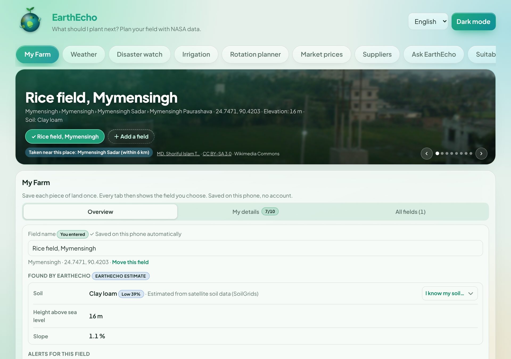
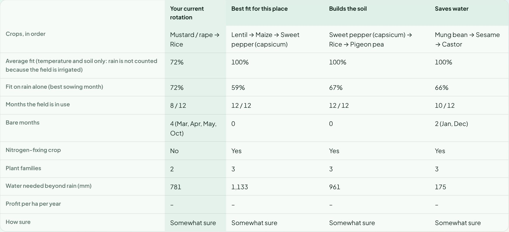
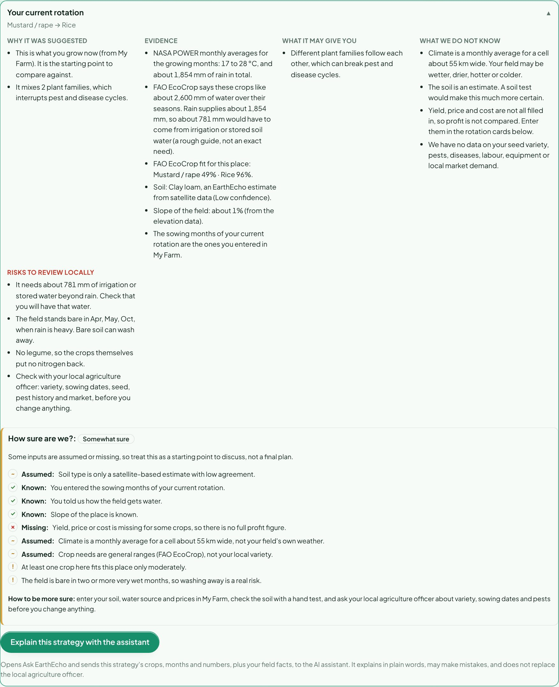
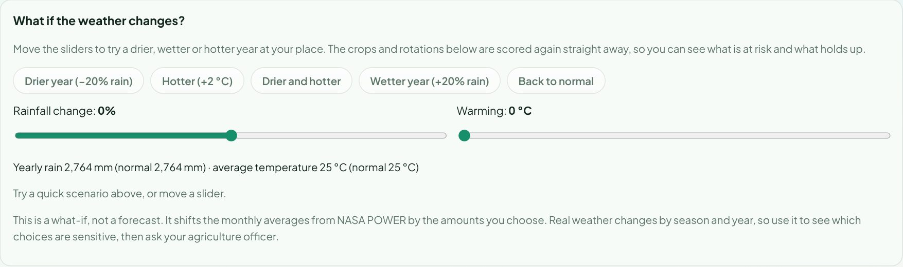
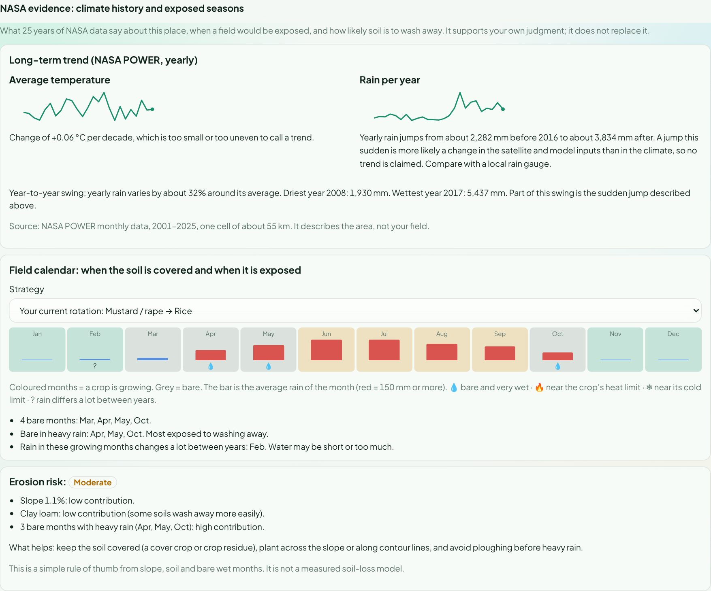
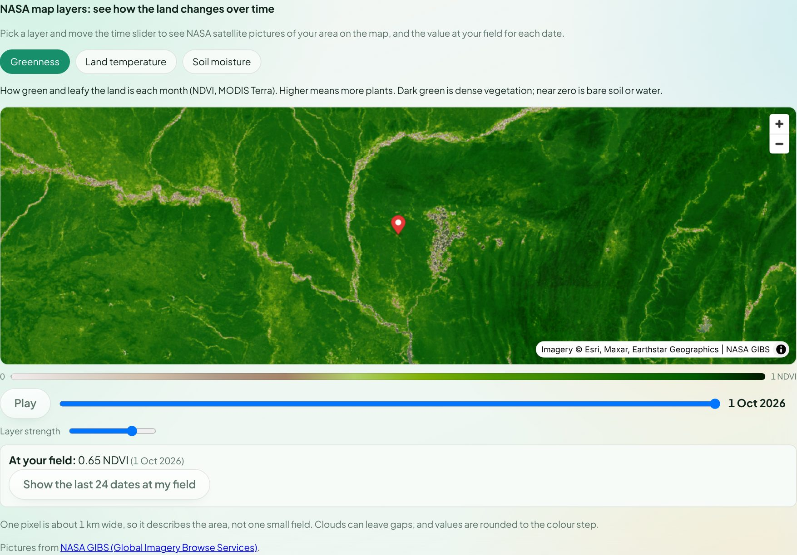
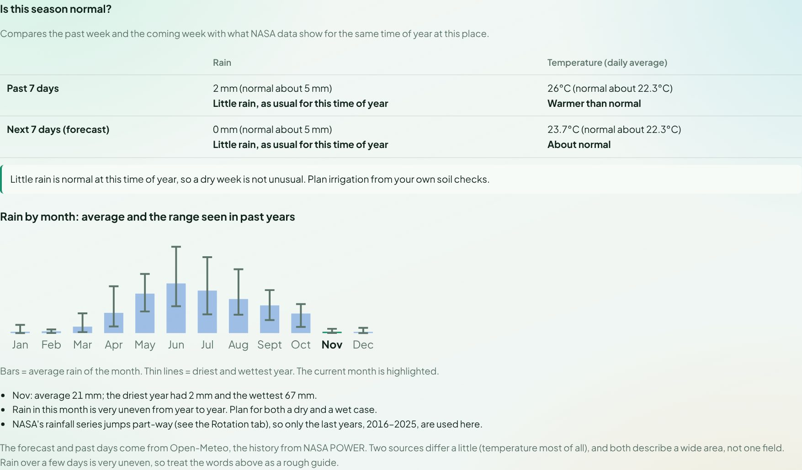

# EarthEcho

**What should I plant next?** EarthEcho is a free, bilingual (English and Bengali) farm-planning web app. A farmer saves a field once. The app then reads NASA satellite and climate data for that field, compares crop-rotation strategies, explains each one in plain words, and says how sure it is. It supports the farmer's own judgment and never replaces it.

    

Built by team **Frontier Zero** for the NASA Space Apps Challenge 2026, challenge **Field Shift: Adapting Farms with NASA Data**. Now in the final round.

**Live app: https://earth-echo-nine.vercel.app/** (no login, works on a phone, installs like an app, opens offline with the last data it saw)

Demo script for judges: [docs/DEMO.md](docs/DEMO.md)

## Contents

1. [See it](#see-it)
2. [What it does for the Field Shift challenge](#what-it-does-for-the-field-shift-challenge)
3. [How a farmer uses it](#how-a-farmer-uses-it)
4. [How the strategies are worked out](#how-the-strategies-are-worked-out)
5. [Tabs](#tabs)
6. [Data sources](#data-sources)
7. [Honest limits](#honest-limits)
8. [Run it on your computer](#run-it-on-your-computer)
9. [Build and deploy](#build-and-deploy)
10. [Project layout](#project-layout)
11. [Privacy](#privacy)

## See it

All pictures below are from the app, using a sample rice field near Mymensingh, Bangladesh. The Bengali versions of every picture are in [docs/screenshots](docs/screenshots) (files ending in `_bn`).

### 1. My Farm: save a field once

The farmer picks the place, and EarthEcho adds its own estimates (soil, height above sea level, slope), always labelled as estimates. Under **My details** the farmer adds what only they know: land size, the crop now and the month it was sown, the crop they want next, past crops, irrigation. Everything the farmer types is marked "You entered" and is used instead of the estimate.



### 2. Rotation planner: compare strategies side by side

The farmer's own rotation next to the best alternatives. The table shows fit to the place, months the field is in use, bare months, nitrogen-fixing crops, plant families, water needed beyond rain, profit when the farmer has entered prices, and how sure the app is.



### 3. Each strategy explained in five parts, with a "How sure are we?" box

Why it was suggested, the evidence, what it may give, what we do not know, and the risks to review locally. The box under it lists what was entered, what was assumed and what is missing. A button sends the strategy to the AI assistant, which explains it in the farmer's language.



### 4. What if the weather changes?

Rain and temperature sliders show how the farmer's crops, and the top strategy, change in a drier, wetter, hotter or cooler season.



### 5. NASA evidence behind the strategies

Twenty-five years of NASA POWER temperature and rain for the place, a month-by-month field calendar (bare months, very wet months, heat and cold limits), and a simple erosion-risk rating. Where the data looks wrong, such as a sudden jump in yearly rain, the app says so and claims no trend.



### 6. NASA map layers with a time slider

Greenness (MODIS NDVI), land temperature (MODIS) and soil moisture (SMAP) from NASA GIBS. The farmer drags the slider through the dates and reads the value at their own field, with a history line for the last dates.



### 7. Weather: is this season normal?

The past week and the coming week of rain and temperature compared with what NASA data show for the same time of year at this place.



## What it does for the Field Shift challenge

The challenge asks for a supportive tool that compares crop-rotation strategies, explains them, and does not replace the farmer's judgment. In the **Rotation planner** tab EarthEcho:

| Challenge need | What EarthEcho does | Where |
|---|---|---|
| Compare several strategies | The farmer's current rotation plus the best alternatives, side by side in one table and in detail cards | Rotation planner, Compare strategies |
| Explain each strategy | Five parts each: why suggested, evidence, benefits, information gaps, risks | Open any strategy card |
| Use NASA data | NASA POWER (25 years of temperature and rain), NASA GIBS layers (MODIS greenness, MODIS land temperature, SMAP soil moisture) with a time slider | NASA evidence; Environment; Weather |
| Let the farmer say what matters | Save water, earn more, improve the soil, lower risk; strategies re-rank. Fit to the place still counts for 40% of each score | Rotation planner, What matters most to you? |
| Show how conditions may change | What-if sliders for rain and temperature | Rotation planner, What if the weather changes? |
| Be honest about uncertainty | A "How sure are we?" box on every strategy: what was entered, assumed or missing | Inside each strategy card |
| Support, not replace, the farmer | The farmer's own values are used and labelled "You entered". Every answer points to the local agriculture officer. No yield or income forecast | My Farm, My details |
| Be understandable | Plain words, a glossary of 21 terms, a "satellite or ground" explainer, English and Bengali, light and dark mode | Data, Learn |
| Explain in the farmer's language | "Explain this strategy" asks the AI assistant, which answers in the app's language | Strategy card |

It is decision support. It never tells a farmer to switch crops, gives no yield or income forecast, and always points to the local agriculture officer.

## Status

All twelve tabs are built and live. Farmers keep many fields; every tab follows the open field. The app is bilingual, works in light and dark mode, passes Lighthouse accessibility, best-practices and SEO checks at 100 on desktop, and works offline after the first visit.

## How a farmer uses it

1. **Open the app.** It opens on **My Farm**. The first time, the farmer picks where their field is (country, division, district, upazila, union, or by tapping the globe or using their location), names it and saves it.
2. **My Farm is the hub.** Every saved field is kept on the phone. There is no login and no account. A field has:
   - **EarthEcho estimates** (soil, height above sea level, slope), always labelled as estimates, with a confidence when the soil data gives one;
   - **The farmer's own details** (land size in bigha, acre, decimal, katha, hectare or square metre; crop now and the month it was sown; crop next; irrigation; who farms it; past crops and when they were sown; notes), all optional, saved as they type.
   - If the farmer knows their soil better than the satellite, they set it. Their value is used everywhere and the original estimate is kept.
3. **Every other tab follows the open field.** A field switcher in the banner changes the field on every tab. Nothing needs to be selected twice.

### Where the farmer's own answers are used

| Answer | Used in |
|---|---|
| Crop now, next crop, past crops | Rotation planner (the current rotation and bare months), field notes in Rotation planner and Suitability, the Irrigation tab (crop and land size), What-if, the AI assistant |
| Sowing months | Rotation planner (timing, bare months, how sure) and the AI assistant. Not used by the Irrigation tab, which has its own growth-stage setting |
| Soil, irrigation | Rotation planner, Suitability, how-sure rating |

Weather, Disaster watch, Market prices, Suppliers and the NASA map do not use these answers.

## How the strategies are worked out

- **Candidate rotations** of two or three crops are built from the FAO EcoCrop climate and soil scores for the place, using NASA POWER monthly averages for temperature and rain.
- **Each rotation is measured**: average fit, months the field is in use, bare months and which of them are very wet, nitrogen-fixing crops, plant families, and the water needed beyond rain.
- **The farmer's own rotation** uses the sowing months they entered. If they did not enter any, the app assumes each crop's best month and says so.
- **Priorities** (save water, earn more, improve the soil, lower risk) change the ranking, but fit to the place always counts for 40%, so a rotation that does not suit the climate cannot win on priorities alone.
- **"How sure"** counts inputs that are known, assumed or missing, and adds flags for weak points (a crop that only moderately fits, a large water gap, a field bare in very wet months). It is a guide, not a statistical confidence interval.
- **Nothing is forecast.** There is no yield or income model.

## Tabs

| Tab | What it gives |
|---|---|
| My Farm | Saved fields, estimates, optional details, alerts for each field, backup file |
| Weather | Forecast and recent weather for the field, and "Is this season normal?" against 25 years of NASA data |
| Disaster watch | Earthquakes, flood and cyclone alerts, river level |
| Irrigation | Water plan for rice and upland crops; uses the crop and land size from My Farm |
| Rotation planner | Strategy comparison, priorities, what-if sliders, NASA evidence, how-sure boxes, profit workings, "Explain this strategy" |
| Market prices | Local food prices from the nearest markets |
| Suppliers | Map of nearby agricultural suppliers |
| Ask EarthEcho | AI assistant with cited answers, in the app's language |
| Suitability | Every crop scored for the place (FAO EcoCrop method); rates the farmer's own crops |
| Soil | SoilGrids soil properties for the place |
| Environment | Vegetation greenness, land temperature, soil moisture, and NASA map layers with a time slider |
| Data | Learn section (glossary, satellite vs ground), then every data source with licence and how it is used |

## Data sources

NASA POWER (climate normals and 2001 to last full year history), NASA SMAP soil moisture and GPM IMERG rain (through NASA GIBS), MODIS vegetation and land temperature (through NASA GIBS, also shown as map layers), ISRIC SoilGrids (soil), FAO EcoCrop (crop limits), Open-Meteo (forecast), USGS and GDACS (earthquakes and alerts), geoBoundaries and Bangladesh Bureau of Statistics (boundaries), WFP food prices from the Humanitarian Data Exchange, Wikimedia Commons (place photographs, free licences only), OpenStreetMap (suppliers). The **Data** tab lists each source with its licence.

Countries: Bangladesh (down to union level), India, Nepal, Myanmar, Pakistan, Bhutan and the USA.

## Honest limits

- Everything is an **estimate**. Soil comes from a 250 m satellite model, climate from monthly averages. The app says so and asks farmers to confirm with their local agriculture officer.
- NASA data describes an area (about 1 to 55 km wide), not one field.
- Crop suitability tells where to look first, not what to plant.
- The strategy comparison is rule-based (fit, bare months, legumes, crop families, water gap, heat and cold months). It is **not a yield model** and does not forecast income.
- In irrigated mode the fit ignores rain, so many alternatives show 100%. A second row shows the fit on rain alone.
- NASA POWER's yearly rainfall for some places (for example Bangladesh) jumps around 2016, which looks like a change in NASA's inputs. The app detects such jumps, claims no trend there and says so.
- The "how sure" rating counts what is measured, assumed or missing. It is a guide, not a statistical confidence interval.
- Data licences are on the Data tab. Still flagged: the FAO EcoCrop page's own user agreement was not read in full, and the Esri satellite basemap's current free-use terms could not be confirmed (fine for a non-commercial demo; check before commercial use).
- The AI assistant answers only from the farm data and its knowledge base, cites its sources, and says when it does not know. It can make mistakes, and it runs on free tiers with a rate limit.
- Saved fields live in the browser of one phone. Clearing browser data removes them. The **Download my fields** file is the backup.

## Run it on your computer

```
npm install
npm run dev
```

Open http://localhost:5173. The `/api` folder runs locally the same way it runs on Vercel.

For the AI assistant, create a file `.env.local` in the project folder (it is never committed):

```
GROQ_API_KEY=your-key
```

`GEMINI_API_KEY` can be added as a backup. On Vercel, add the same names under Project Settings, Environment Variables.

## Build and deploy

```
npm run build
```

Vercel builds and publishes on every push to `main`. `vercel.json` sets the time limits of the slower API functions.

## Project layout

- `src/` the React app. One file per tab, `fields.js` for saved fields, `strategy.js` for the strategy rules, `trust.js` for the how-sure rating, `i18n*.js` for English and Bengali text.
- `api/` the server functions (data feeds, NASA trends and map layers, and the assistant) and `api/_lib/` shared code, including the assistant's knowledge base.
- `public/` boundaries, crop table, prepared photo galleries, the app icons and the offline service worker.
- `docs/` the demo script and the screenshots used in this file.

## Privacy

No account, no tracking and no advertising. Fields and details stay on the device. The place's coordinates are sent to the data services (NASA, Open-Meteo, SoilGrids and others) to fetch its data, and the browser loads NASA map pictures for the area directly from NASA. Questions to the assistant, and the strategy sent by "Explain this strategy", go to an AI provider (Groq, or Google Gemini as a backup) together with the place, the crops and the field notes needed to answer. Google may use text sent through its free Gemini tier to improve its products, so the app tells farmers not to write personal details in notes.
